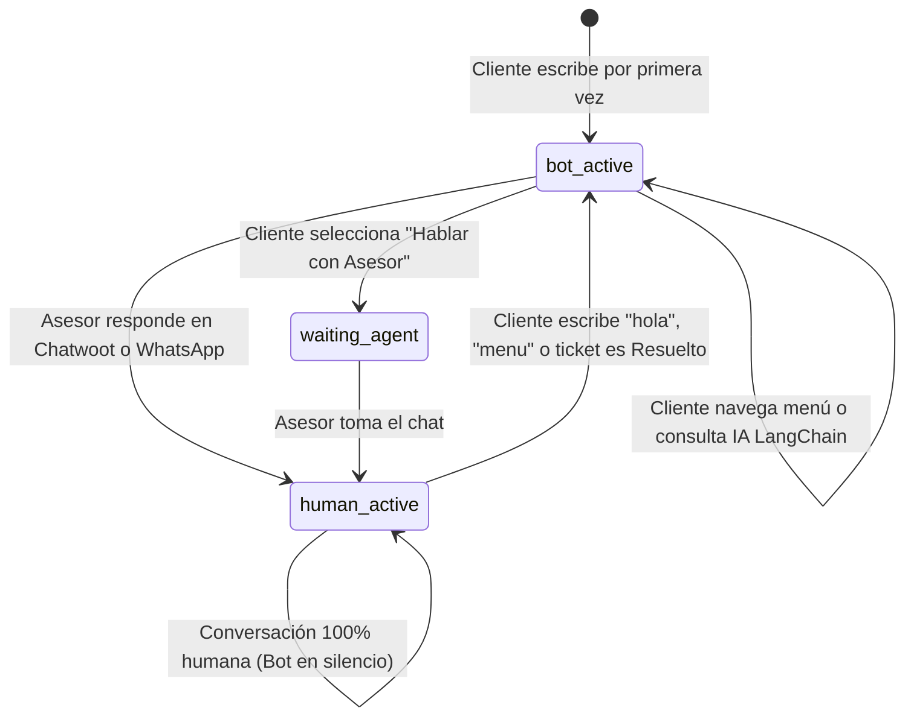

# DOCUMENTACIÓN TÉCNICA DEL SISTEMA
## Chatbot IA Automotriz con LangChain, WhatsApp (Evolution API) y Chatwoot Cloud
### Concesionario AutoEcuador Motors 2026

---

## 1. Resumen Ejecutivo y Visión General

El sistema es una solución empresarial de **Inteligencia Artificial Conversacional y Atención Omnicanal** diseñada específicamente para el sector automotriz en Ecuador. Integra la mensajería instantánea de **WhatsApp** con una arquitectura de IA nativa en Python basada en **LangChain**, un almacén de memoria conversacional en **Redis**, persistencia transaccional y auditoría en **PostgreSQL**, y una consola de control humano multilínea en **Chatwoot Cloud**.

El ecosistema permite que hasta **25 números telefónicos de WhatsApp** (correspondientes a diferentes sucursales, asesores o campañas publicitarias) sean atendidos de forma automatizada por un bot inteligente y supervisados/gestionados por **un único agente humano** bajo una sola licencia de **$19 USD/mes en Chatwoot**, eliminando costos adicionales de licenciamiento.

---

## 2. Arquitectura General del Sistema

```mermaid
flowchart TD
    subgraph ClientZone ["Canal de Clientes"]
        WA_USR["📱 WhatsApp Cliente (Móvil / Web)"]
        WA_ADV["📱 WhatsApp Asesor (Móvil / Web Propio)"]
    end

    subgraph MessagingLayer ["Capa de Mensajería & Gateway"]
        EVO["⚡ Evolution API v2 (Node.js/Baileys)<br/>Puerto Interno: 8080 | Host: 8082<br/>Instancias: sucursal_centro, sucursal_2... sucursal_25"]
        NGROK["🌐 Túnel Seguro HTTPS (Ngrok)<br/>usable-thorn-kabob.ngrok-free.dev"]
    end

    subgraph BackendCore ["Backend Central (Python 3.11 / FastAPI)"]
        WH_ROUTER["📥 Webhook Router (webhooks.py)<br/>/webhooks/whatsapp | /webhooks/chatwoot"]
        DEDUP["🛡️ Motor Antirebote & Deduplicación<br/>(Hashes MD5 + Cerrojos Atómicos Redis)"]
        LID_RESOLV["🔍 Resolver de Identidades WhatsApp LID<br/>(@lid ➔ Teléfono Real +593...)"]
        LC_SERVICE["🧠 LangChain Automotive AI Service<br/>(langchain_service.py)<br/>Persona: Alex (Asesor Virtual 2026)"]
        FLOW_ENGINE["⚙️ Máquina de Estados & Menús Interactivos<br/>(interactive_flow_service.py)"]
        METRICS_API["📊 Metrics API & Reverse Proxy<br/>(metrics_api.py)"]
    end

    subgraph DataStorage ["Capa de Persistencia & Memoria"]
        REDIS["⚡ Redis 7 (ferreteria-redis-new:6379)<br/>- Historial Turnos LangChain (chat_history:sess)<br/>- Firmas Antirebote (wa_to_cw, cw_to_evo)<br/>- Mapeo Instancia/LID (user_instance, lid_map)<br/>- Métrica de Espera FRT (cust_wait_ts)"]
        POSTGRES["🐘 PostgreSQL 15 (ferreteria-postgres-new:5432)<br/>- Base ferreteria_chatbot: conversaciones, mensajes, cotizaciones<br/>- Base evolution: sesiones de WhatsApp, contactos, llaves"]
    end

    subgraph HumanDesk ["Mesa de Ayuda Omnicanal"]
        CW_CLOUD["🏢 Chatwoot Cloud (app.chatwoot.com)<br/>Account ID: 193795 | Inbox: 150556 (WhatsApp)<br/>Agente Único: Christianb ($19/mes)<br/>Atributos Personalizados & Labels en Tiempo Real"]
    end

    subgraph InteractiveUI ["Interfaces Interactivas"]
        CATALOG["🚗 Vitrina Virtual & Cotizador Webview<br/>/catalogo-autos"]
        MET_DASH["📈 Dashboard de Métricas en Vivo<br/>/metricas"]
    end

    WA_USR <-->|Mensajes Texto / Audio / Foto / Docs| EVO
    WA_ADV <-->|Mensajes Escritos desde Teléfono| EVO
    EVO -->|POST Webhook Global| WH_ROUTER
    WH_ROUTER --> DEDUP
    DEDUP --> LID_RESOLV
    LID_RESOLV <--> REDIS
    LID_RESOLV --> FLOW_ENGINE
    FLOW_ENGINE --> LC_SERVICE
    LC_SERVICE <-->|Lectura/Escritura Historial 6 Turnos| REDIS
    FLOW_ENGINE <-->|Auditoría Transaccional| POSTGRES
    WH_ROUTER <-->|REST API HTTPS (Contactos, Chats, Notas, Labels)| CW_CLOUD
    CW_CLOUD -->|Webhook Asesor: message_created| NGROK
    NGROK --> WH_ROUTER
    WH_ROUTER -->|POST /message/sendText/:instance| EVO
    WA_USR -->|Webview sin salir de WhatsApp| CATALOG
    CW_CLOUD -.->|Supervisión| MET_DASH
    MET_DASH <--> METRICS_API
    METRICS_API <--> CW_CLOUD
```

---

## 3. Especificación de Componentes y Puertos

| Servicio | Contenedor Docker | Puerto Interno | Puerto Host | Descripción |
| :--- | :--- | :--- | :--- | :--- |
| **Backend API** | `ferreteria-backend` | `8080` | `8085` | FastAPI, LangChain 1.4.7, SQLAlchemy Async, Routers. |
| **WhatsApp Gateway** | `ferreteria-whatsapp-gateway-new` | `8090` | `8095` | Reverse proxy para Ngrok, frontend de `/catalogo-autos` y `/metricas`. |
| **Evolution API** | `evolution-api` | `8080` | `8082` | Motor Baileys WhatsApp v2.3.7, gestión de sockets QR y sesiones. |
| **PostgreSQL** | `ferreteria-postgres-new` | `5432` | `5432` | BD `ferreteria_chatbot` y BD `evolution`. |
| **Redis** | `ferreteria-redis-new` | `6379` | `6380` | Memoria de LangChain, semáforos antirebote, métricas temporales. |
| **Qdrant Vector DB** | `ferreteria-qdrant-new` | `6333` | `6333` | Base de datos vectorial para embeddings semánticos. |
| **Ngrok Tunnel** | Proceso host / daemon | - | - | Túnel HTTPS público con dominio fijo `usable-thorn-kabob.ngrok-free.dev`. |

---

## 4. Motor de Inteligencia Artificial con LangChain Nátivo

### 4.1 Reemplazo de Flowise por Código Python Puro
Anteriormente, el sistema dependía de un contenedor externo de Node.js (`flowise-new`) en el puerto 3000. Se desacopló por completo debido a:
1. **Latencia de Red:** Cada pregunta requería múltiples saltos HTTP adicionales entre Python y Node.js.
2. **Dependencia Externa:** Si el contenedor Node.js se quedaba sin memoria, todo el bot dejaba de responder.
3. **Mantenimiento en Código:** Al estar escrito en Python nativo ([`langchain_service.py`](file:///c:/Users/User/Desktop/KEVIN/ChatbotFlowise/backend/app/services/langchain_service.py)), el prompt, el conocimiento de vehículos, las reglas de crédito ecuatorianas y la memoria en Redis se controlan directamente en el repositorio bajo control de versiones Git.

### 4.2 Arquitectura de `LangChainService`
Ubicación: [`backend/app/services/langchain_service.py`](file:///c:/Users/User/Desktop/KEVIN/ChatbotFlowise/backend/app/services/langchain_service.py)

* **Persona del Asesor:** *Alex*, consultor comercial ejecutivo de AutoEcuador Motors (Ecuador, 2026).
* **Base de Conocimiento Automotriz Oficial 2026:**
  - **Camionetas 4x4:** Chevrolet D-Max High Country 3.0L Diésel 4x4 (\$34,990 USD), Toyota Hilux Doble Cabina 2.4L (\$38,490 USD), Great Wall Poer Luxury 2.0L Turbo 4x4 (\$28,990 USD).
  - **Híbridos Cero Pico y Placa:** Toyota Yaris Cross Híbrido 1.5L (\$27,990 USD, consumo hasta 85 km/galón, exento de Pico y Placa en Quito todos los días, garantía de batería de 8 años).
  - **SUVs Familiares:** Chery Tiggo 4 Pro (\$18,490 USD), Kia Sonet (\$19,990 USD), Chevrolet Tracker RS (\$22,990 USD), Kia Sportage LX (\$26,490 USD), Hyundai Tucson NX4 Advance (\$29,990 USD).
  - **Reglas Financieras:** Entradas desde el 20%, plazos de 12 a 60 meses, alianzas con Banco Pichincha, Produbanco, Banco Guayaquil, Coac Policía Nacional.
  - **Servicios:** Plan Retoma (tasación de usados como parte de pago), Test Drive gratuito a domicilio o showroom.

### 4.3 Memoria Conversacional en Redis (`chat_history:{session_id}`)
Cada cliente cuenta con una sesión única (`derive_session_id(phone)`).
- **Almacenamiento:** Lista en Redis bajo la clave `chat_history:{session_id}`.
- **Ventana Deslizante:** Se recuperan los últimos 6 mensajes (3 turnos completos de usuario y asistente) para alimentar el contexto de LangChain.
- **TTL Automático:** 7200 segundos (2 horas de inactividad). Al expirar, la memoria se limpia automáticamente para no mezclar contextos antiguos.

### 4.4 Proveedores LLM y Motor de Respaldo Semántico
1. **Modo Cloud (OpenAI / Groq):** Si existen variables de entorno `OPENAI_API_KEY` o `GROQ_API_KEY`, LangChain instancia `ChatOpenAI` o `ChatGroq` con temperatura `0.3` y `max_tokens=600`.
2. **Modo Resiliente Local (Inferencia Semántica Nativa):** Si no hay API Keys activas o hay un fallo de conexión a Internet, el método `_native_semantic_engine()` toma el control de forma inmediata evaluando intenciones semánticas sobre modelos, precios, requisitos bancarios y sedes sin que el cliente perciba ninguna interrupción.

---

## 5. Algoritmo de Enrutamiento y Resolución de Identidades LID

### 5.1 El Problema del WhatsApp LID (`@lid`)
En versiones modernas de WhatsApp (especialmente con múltiples dispositivos y WhatsApp Web), Meta asigna a los usuarios identificadores efímeros de privacidad terminados en `@lid` (ejemplo: `30713428635898@lid`). 
Si el webhook toma este identificador como número telefónico:
- En Chatwoot se genera un contacto con teléfono falso `+30713428635898`.
- Chatwoot rechaza el número con error `422 Unprocessable Entity` o crea una conversación duplicada aislada.
- El asesor ve la conversación vacía y no puede responder al cliente real.

### 5.2 Algoritmo de Resolución en Cascada
Implementado en [`backend/app/api/webhooks.py`](file:///c:/Users/User/Desktop/KEVIN/ChatbotFlowise/backend/app/api/webhooks.py):

```python
target_jid = remote_jid
if "@lid" in target_jid:
    # 1. Intentar obtener teléfono de remoteJidAlt provisto por Baileys
    if remote_jid_alt and "@s.whatsapp.net" in remote_jid_alt:
        target_jid = remote_jid_alt
    # 2. Intentar obtener participante del mensaje
    elif participant and "@s.whatsapp.net" in participant:
        target_jid = participant
    else:
        # 3. Buscar en caché Redis previamente mapeada
        lid_clean = target_jid.split("@")[0].split(":")[0]
        cached_p = await redis_client.get(f"lid_map:{lid_clean}")
        if cached_p:
            target_jid = f"{cached_p}@s.whatsapp.net"
        else:
            # 4. Consultar en la base de datos de Evolution (tabla IsOnWhatsapp o Contact)
            conn = await asyncpg.connect(EVOLUTION_DB_URI)
            row = await conn.fetchrow('SELECT "remoteJid" FROM "IsOnWhatsapp" WHERE "jidOptions" LIKE $1 LIMIT 1', f"%{lid_clean}%")
            if row:
                target_jid = row['remoteJid']
                await redis_client.set(f"lid_map:{lid_clean}", target_jid.split("@")[0], ex=604800)
```
Resultado: Todo mensaje entrante se asocia **siempre** al número real en formato E.164 (ej: `593984407038`).

---

## 6. Sistema Criptográfico Antirebote y Prevención de Bucles

Uno de los mayores desafíos en la integración WhatsApp ⇄ Chatwoot es el **bucle de rebote infinito**:
1. El asesor escribe en WhatsApp Móvil.
2. El webhook de Evolution lo sube a Chatwoot.
3. Chatwoot emite un webhook `message_created`.
4. El backend recibe el webhook de Chatwoot y lo reenvía a WhatsApp.
5. El cliente/asesor recibe el mensaje dos veces.

### 6.1 Matriz de Protección Antirebote

```
┌─────────────────────────┐       wa_to_cw:{sig}       ┌─────────────────────────┐
│     WhatsApp Móvil      │ ─────────────────────────> │     Chatwoot Cloud      │
│  (Asesor escribe chat)  │                            │  (Aparece en pantalla)  │
└─────────────────────────┘                            └────────────┬────────────┘
             ▲                                                      │ Webhook
             │                 cw_to_evo:{sig}                      │ message_created
             └──────────────────────────────────────────────────────┘
              [DESCARTADO: Detecta wa_to_cw activo -> NO reenvía]
```

1. **Deduplicación de Peticiones Concurrentes (`evo_msg_seen:{id}`):**
   - Comando atómico: `redis.set(f"evo_msg_seen:{msg_id}", "1", ex=300, nx=True)`.
   - Si Evolution envía 2 peticiones idénticas en el mismo milisegundo, la segunda recibe `False` y se descarta como `duplicate_webhook`.
2. **Cerrojo WhatsApp ➔ Chatwoot (`wa_to_cw:{sig}`):**
   - Cuando el asesor escribe en su celular, se genera un hash:  
     `sig = md5(phone + ":" + text.strip())`.
   - Se guarda en Redis `wa_to_cw:{sig}` con expiración de 60 segundos.
   - Cuando Chatwoot dispara su webhook hacia el backend, el backend consulta `wa_to_cw:{sig}`. Al encontrarlo, responde `ignored_origin_whatsapp` y **cancela el reenvío a WhatsApp**.
3. **Cerrojo Chatwoot ➔ WhatsApp (`cw_to_evo:{sig}`):**
   - Cuando el asesor escribe desde la web de Chatwoot, se guarda `cw_to_evo:{sig}`.
   - Cuando Evolution confirma el envío con `fromMe: true`, el backend detecta `cw_to_evo:{sig}` y responde `ignored_echo_chatwoot`, evitando duplicar el mensaje en Chatwoot.
4. **Desactivación de Webhook Redundante en Evolution API:**
   - Se deshabilitó el webhook por instancia en `sucursal_centro` (`enabled: false`).
   - Se mantiene únicamente el **Webhook Global** (`WEBHOOK_GLOBAL_ENABLED=true`), garantizando que solo exista 1 emisión de evento por mensaje.

---

## 7. Integración Omnicanal con Chatwoot Cloud REST API

La clase [`ChatwootService`](file:///c:/Users/User/Desktop/KEVIN/ChatbotFlowise/backend/app/services/chatwoot_service.py) gestiona la comunicación con Chatwoot Cloud Account `193795`:

```
POST https://app.chatwoot.com/api/v1/accounts/193795/
├── contacts/search?q={phone}                   ➔ Busca contacto por E.164
├── contacts/                                   ➔ Crea contacto nuevo
├── conversations/                              ➔ Crea conversación vinculada al Inbox 150556
├── conversations/{id}/messages                 ➔ Envía mensajes (incoming/outgoing)
├── conversations/{id}/messages (multipart)     ➔ Sube archivos adjuntos (fotos/audios/docs)
├── conversations/{id}/custom_attributes        ➔ Actualiza atributos en la barra lateral
├── conversations/{id}/labels                   ➔ Aplica etiquetas de color
└── conversations/{id}/toggle_status            ➔ Cambia estado a open/resolved
```

### Atributos Personalizados en Tiempo Real (`custom_attributes`)
Cada mensaje entrante clasifica al lead y actualiza la ficha del cliente en Chatwoot:
- `tiempo_respuesta_frt`: Tiempo en segundos desde que el cliente escribió hasta que el asesor respondió.
- `flujo_actual`: Categoría activa (*Camionetas 4x4*, *Híbridos Cero Pico y Placa*, *SUVs Familiares*, *Simulación Crédito*, *Plan Retoma*).
- `modelo_interes`: Modelo específico consultado (*Chevrolet D-Max 3.0L*, *Toyota Hilux*, *Toyota Yaris Cross Híbrido*).
- `sucursal_preferida`: Showroom asignado (*Quito Centro*, *Quito Norte*, *Guayaquil*, *Cuenca*).
- `adjuntos_recibidos`: Registro de fotos o archivos enviados por el cliente.

---

## 8. Máquina de Estados de la Conversación

El ciclo de vida de la conversación se almacena en PostgreSQL (`chatbot_conversations.status`):



* **`bot_active`:** El motor de LangChain y los flujos interactivos responden automáticamente.
* **`human_active` / `handed_over`:** El bot se apaga completamente para esa sesión (`chatwoot_direct_mode`). Toda la conversación es gestionada exclusivamente por el asesor humano.
* **Reactivación:** Si el asesor presiona "Resolver" en Chatwoot o el cliente escribe palabras de inicio (*"hola"*, *"menu"*, *"reiniciar"*), el estado regresa a `bot_active`.

---

## 9. Soporte Multilínea: Hasta 25 Números por $19 USD/mes

### 9.1 Modelo de Licenciamiento de Chatwoot Cloud
* **Precio:** \$19 USD por **agente humano** al mes.
* **Bandejas (Inboxes):** **Ilimitadas y gratuitas**.
* **Canales API:** **Ilimitados y gratuitos**.

### 9.2 Enrutamiento Dinámico en Evolution API
1. En Evolution API se crean las instancias: `sucursal_1`, `sucursal_2`, ..., `sucursal_25`.
2. Cuando un cliente escribe a cualquiera de los números, el webhook registra en Redis:  
   `user_instance:{clean_phone} = "sucursal_X"` con TTL de 30 días.
3. Cuando el asesor único Christianb responde en Chatwoot, `_gateway_send_text` consulta Redis:
   ```python
   target_instance = await rc.get(f"user_instance:{clean_p}") or "sucursal_centro"
   await client.post(f"http://evolution-api:8080/message/sendText/{target_instance}", ...)
   ```
4. El mensaje sale exactamente por el número telefónico por el cual el cliente escribió.
5. **Costo de Licencias Adicionales:** **\$0 USD**.

---

## 10. Historias de Usuario Técnicas

### HU-TEC-01: Inferencia Semántica y Memoria en Redis
* **Como:** Motor de orquestación de IA.
* **Quiero:** Consultar `chat_history:{session_id}` antes de invocar a LangChain.
* **Para:** Entregar respuestas con contexto acumulado de turns previos sin sobrecargar la memoria RAM del servidor.
* **Criterios de Aceptación:**
  - Si existen turnos previos en Redis, se inyectan como lista de mensajes `HumanMessage` y `AIMessage`.
  - La respuesta generada se almacena en Redis con TTL de 7200 segundos.
  - El tiempo de respuesta total no debe exceder los 800 ms.

### HU-TEC-02: Resolución Transparente de Identidades LID
* **Como:** Webhook router de WhatsApp.
* **Quiero:** Detectar si el campo `remoteJid` contiene `@lid` y resolverlo a su `remoteJidAlt` o registro en PostgreSQL de Evolution.
* **Para:** Garantizar que Chatwoot y PostgreSQL utilicen el número telefónico real del cliente.
* **Criterios de Aceptación:**
  - Ante un `remoteJid` como `30713428635898@lid`, se resuelve a `593984407038@s.whatsapp.net`.
  - El resultado se cachea en Redis bajo `lid_map:{lid}` por 7 días.

### HU-TEC-03: Supresión de Ecos en Tiempo Real
* **Como:** Enrutador bidireccional.
* **Quiero:** Comparar los hashes MD5 de los mensajes enviados contra `wa_to_cw` y `cw_to_evo`.
* **Para:** Evitar que un mensaje escrito en una plataforma se duplique al propagarse a la otra.
* **Criterios de Aceptación:**
  - Un mensaje originado en WhatsApp nunca debe ser reenviado a WhatsApp tras el webhook de Chatwoot.
  - Un mensaje originado en Chatwoot nunca debe ser reingresado a Chatwoot tras el webhook de confirmación de WhatsApp.

---

## 11. Estructura de Directorios del Proyecto

```
ChatbotFlowise/
├── backend/
│   ├── app/
│   │   ├── api/
│   │   │   ├── webhooks.py          # Enrutador principal de WhatsApp y Chatwoot
│   │   │   ├── metrics_api.py       # API REST de atributos y métricas de Chatwoot
│   │   │   ├── vehicles_api.py      # Endpoints de cotización y catálogo
│   │   │   ├── admin.py             # Chat test y administración
│   │   │   └── testing.py           # Endpoint de simulación local
│   │   ├── services/
│   │   │   ├── langchain_service.py # Motor IA LangChain en Python puro
│   │   │   ├── chatwoot_service.py  # Conector API REST Chatwoot Cloud
│   │   │   ├── interactive_flow_service.py # Menús y botones interactivos
│   │   │   └── session_service.py   # Gestión de sesiones y hashes de teléfono
│   │   ├── db/
│   │   │   ├── tables.py            # Modelos SQLAlchemy (conversations, messages)
│   │   │   └── session.py           # Conexión async a PostgreSQL
│   │   └── config.py                # Variables de entorno y configuración
│   └── pyproject.toml               # Dependencias (langchain, fastapi, redis, etc.)
├── whatsapp-gateway/
│   └── app/
│       └── main.py                  # Reverse proxy, servidor estático catálogo y métricas
├── catalogo_autos.html              # Frontend responsivo Webview de vitrina y crédito
├── metricas_dashboard.html          # Panel web de gestión de métricas de Chatwoot
├── docker-compose.yml               # Orquestación de contenedores Docker
├── DOCUMENTACION_TECNICA.md         # Documento técnico oficial
└── MANUAL_DE_USUARIO.md             # Manual de usuario y operación del sistema
```
