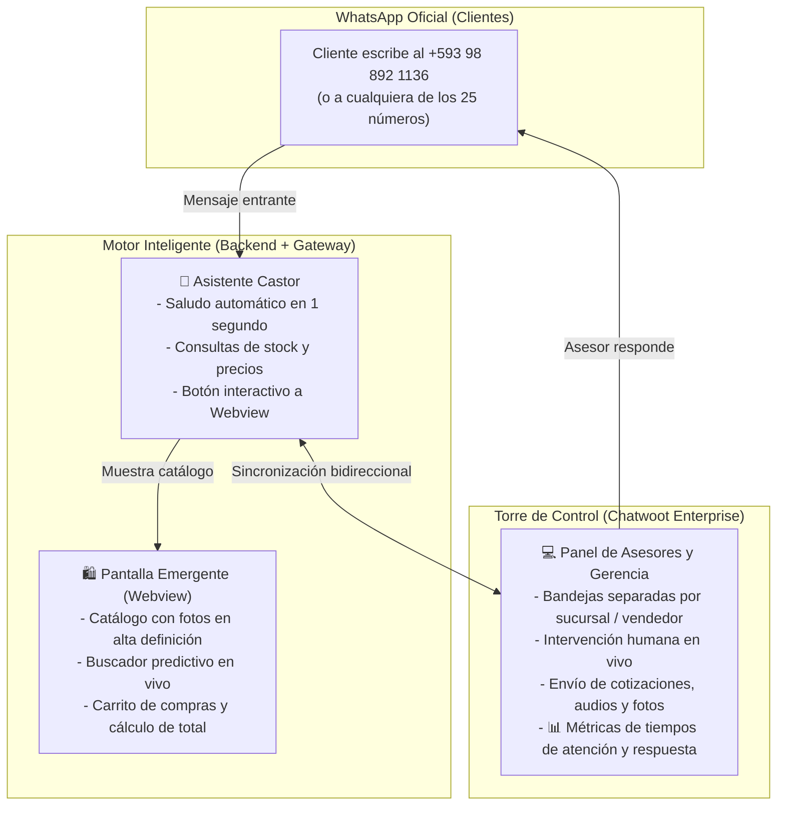

# Sistema Omnicanal de Ventas y Atención con WhatsApp y Chatwoot
## Mega Ferretería Bonilla — Arquitectura, Funcionalidades y Guía de Demostración

---

## 1. Resumen Ejecutivo

Este sistema transforma la atención comercial y de ventas de **Mega Ferretería Bonilla**, pasando de celulares físicos dispersos a una **Torre de Control Digital Centralizada** capaz de operar desde 1 hasta **25 números de WhatsApp simultáneos**.

Combina dos fuerzas complementarias:
1. **Inteligencia Artificial y Automatización 24/7:** El asistente virtual **Castor** saluda al instante, muestra el catálogo interactivo con fotos y precios, gestiona el carrito de compras y cotiza productos sin demoras.
2. **Atención Humana Profesional:** En cuanto se requiere negociación o cierre de venta, el vendedor atiende desde **Chatwoot**, manteniendo al cliente en el mismo chat de WhatsApp sin interrupciones.



---

## 2. Tecnologías Utilizadas y Razón de Elección

| Componente | Tecnología | ¿Por qué se utilizó? |
| :--- | :--- | :--- |
| **Chatbot Inteligente** | Python 3.11, FastAPI, SQLAlchemy, Redis | Velocidad extrema de respuesta (< 1s), escalabilidad y conexión directa con el catálogo de productos. |
| **Catálogo & Pantalla Emergente** | HTML5, CSS3, Tailwind, JavaScript Vanilla (PWA) | Abre como una ventana emergente nativa (*In-App Webview*) dentro de WhatsApp sin obligar al cliente a salir a un navegador externo ni instalar apps. |
| **Pasarela WhatsApp Oficial** | Meta Cloud API (WhatsApp Business Platform) | Comunicación oficial avalada por Meta, sin riesgo de bloqueos por spam de apps piratas, con soporte de botones CTA y plantillas. |
| **Torre de Control Omnicanal** | Chatwoot Enterprise (Docker Self-Hosted) | Plataforma de atención multilínea. Al estar alojada en tu propio servidor (Docker), **no tiene costos de suscripción mensual por usuario, no tiene límites de agentes ni de mensajes, y los tokens de API están 100% desbloqueados**. |
| **Base de Datos & Cache** | PostgreSQL 16 + Redis 7 | Almacenamiento seguro de historiales de pedidos, clientes y sesiones activas. |

---

## 3. ¿Qué Hace el Sistema? (Funcionalidades Principales)

### A. La Pantalla Emergente (Catálogo y Carrito en WhatsApp)
* Cuando el cliente escribe al WhatsApp de la ferretería, el bot le entrega un botón interactivo: **`🛍️ Abrir Catálogo y Carrito`**.
* Al tocarlo, se despliega una pantalla dentro del mismo WhatsApp:
  * **Buscador en tiempo real:** Encuentra herramientas, cemento, tornillería, pinturas y accesorios al instante.
  * **Tarjetas de productos:** Foto clara, descripción técnica, precio unitario y botón para sumar al carrito.
  * **Carrito dinámico:** Calcula subtotales, impuestos y total de la compra.
  * **Envío de pedido:** Con un clic, el pedido regresa al chat de WhatsApp y se registra en Chatwoot para despacho.

### B. Transición Suave entre Bot y Asesor Humano (Handoff)
* Si el cliente escribe *"quiero hablar con un asesor"* o pide una negociación especial:
  1. El bot le informa cordialmente que un vendedor atenderá su solicitud.
  2. En Chatwoot, el chat salta a la pestaña de pendientes.
  3. En el momento en que el vendedor escribe una palabra desde Chatwoot, **el bot se silencia automáticamente** (`human_active`) para no interrumpir al asesor.
  4. Cuando el vendedor cierra el trato y marca el chat como **"Resuelto"**, el bot se reactiva para la próxima ocasión.

### C. Supervisión Gerencial y Métricas en Tiempo Real
Desde la sección de **Informes** en Chatwoot:
* **Tiempo de Primera Respuesta (FRT):** Mide con exactitud cuántos minutos tarda cada vendedor en contestar un cliente.
* **Tiempo de Resolución (ART):** Cuánto dura una atención comercial de principio a fin.
* **Rendimiento Individual:** Cuántas conversaciones atendió el Vendedor A vs el Vendedor B.
* **Auditoría Interna:** Notas amarillas privadas donde los supervisores pueden guiar a los vendedores sin que el cliente lo lea.

---

## 4. Guión Paso a Paso para la Demostración en Vivo

Para tu presentación con directivos o clientes, sigue estos pasos:

### Paso 1: Abrir la Torre de Control
1. Abre tu navegador y entra a:  
   👉 [http://localhost:3010/app/accounts/1/dashboard](http://localhost:3010/app/accounts/1/dashboard)
2. Inicia sesión con:
   - **Correo:** `keving@ingelsi.com` (o `gerencia@megaferreteriabonilla.com`)
   - **Contraseña:** `Admin12345!`

### Paso 2: Mostrar la Conversación de Demostración
1. En la barra lateral izquierda, haz clic en **"Conversations"** (o *Todas las conversaciones*).
2. Verás en vivo la conversación de:  
   **`Ing. Roberto Andrade (+593 98 892 1136)`**.
3. Haz clic en ella para que los evaluadores vean:
   - El mensaje entrante del cliente cotizando cemento y taladros.
   - La respuesta inmediata del Asesor Virtual Castor con los precios oficiales.
   - El enlace directo al Catálogo y Carrito interactivo.
   - La solicitud del cliente para coordinar pago y entrega con un asesor humano.

### Paso 3: Demostrar la Pantalla Emergente del Catálogo
Abre en una pestaña del navegador el catálogo interactivo para que vean la experiencia del cliente:
👉 [http://localhost:8092/catalogo?phone=593988921136&sucursal=Centro](http://localhost:8092/catalogo?phone=593988921136&sucursal=Centro)
*(Muestra cómo se buscan productos, se visualizan las fotos y se agregan al carrito con total fluidez).*

### Paso 4: Responder en Vivo como Asesor Humano
1. Regresa a la pestaña de Chatwoot.
2. En la caja de texto inferior de la conversación de Roberto Andrade, escribe:
   > *"Estimado Roberto, le saluda Carlos de Ventas. Tenemos los 15 sacos listos para despacho inmediato hoy mismo a las 15:00. ¿Desea pagar con transferencia o contra entrega al recibir el camión?"*
3. Haz clic en **Enviar**.
4. Señala cómo la plataforma registra quién respondió, a qué hora exacta y silencia al bot para una atención 100% personalizada.

### Paso 5: Mostrar el Módulo de Informes y Métricas
1. En el menú de la izquierda, haz clic en el icono de gráficas **"Reports" (Informes)**.
2. Muestra:
   - Resumen de conversaciones por canal.
   - Tiempos de atención por agente.
   - Cómo Gerencia puede auditar todas las sucursales sin depender de revisar celulares físicos.

---

## 5. Escalabilidad a 25 Números de WhatsApp

El sistema está arquitecturado con un **Mapeador Multilínea** en su archivo de configuración:

```json
{
  "PHONE_ID_CENTRO": {"inbox_id": 1, "phone_display": "+593 98 440 7038", "sucursal": "Matriz Centro"},
  "PHONE_ID_NORTE":  {"inbox_id": 2, "phone_display": "+593 98 892 1136", "sucursal": "Sucursal Norte"},
  "PHONE_ID_SUR":    {"inbox_id": 3, "phone_display": "+593 99 245 1085", "sucursal": "Sucursal Sur"}
}
```

Cada nuevo número que adquiera la empresa se conecta en 2 pasos:
1. Se añade la entrada en Chatwoot (Canal API).
2. Se registra el ID de Meta en el backend.
El sistema enruta los mensajes entrantes al bot y a la bandeja respectiva de forma automática y transparente.
