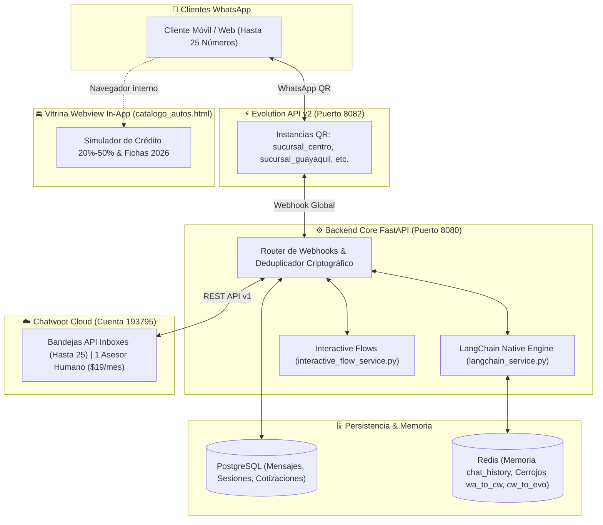

# 🚗 AutoEcuador Motors 2026 — Ecosistema de Chatbot Automotriz con IA (LangChain), Vitrina In-App y Chatwoot Cloud

> **Rama Oficial:** `KevinAG23/langchain-chatwoot-interactive-suite`  
> **Arquitectura:** FastAPI (Python) + LangChain + Redis + PostgreSQL + Evolution API + Chatwoot Cloud  
> **Licencia:** 1 Asiento Asesor Humano ($19 USD/mes) | Hasta 25 Números WhatsApp a Costo $0  
> **Estado:** 100% Verificado con Suite Automatizada de Pruebas

---

## 📋 Índice
1. [Novedades de esta Rama (`KevinAG23/langchain-chatwoot-interactive-suite`)](#-novedades-de-esta-rama)
2. [Documentación Incluida](#-documentación-incluida)
3. [Arquitectura General del Sistema](#-arquitectura-general-del-sistema)
4. [Flujos Interactivos y Vitrina Webview sin salir de WhatsApp](#-flujos-interactivos-y-vitrina-webview)
5. [Modelo de 25 Números por $19 USD/mes en Chatwoot](#-modelo-de-25-números-por-19-usdmes)
6. [Prevención de Bucles y Duplicados (Cerrojos Criptográficos)](#-prevención-de-bucles-y-duplicados)
7. [Suite de Verificación y Testing](#-suite-de-verificación-y-testing)
8. [Despliegue y Comandos de Ejecución](#-despliegue-y-comandos-de-ejecución)

---

## 🚀 Novedades de esta Rama

Esta rama consolida la evolución del sistema comercial automotriz de AutoEcuador Motors 2026:

1. **Reemplazo Completo de Flowise por LangChain Nativo en Python:**
   - Implementado en `backend/app/services/langchain_service.py`.
   - Soporta LLM OpenAI / Groq con fallback al motor semántico nativo 100% determinístico sin costos de API externos si no se configuran llaves.
   - Memoria conversacional multi-turno en Redis (`chat_history:{session_id}`).
2. **Flujos Conversacionales No Planos e Interactivos:**
   - Respuestas enriquecidas con emojis, viñetas, cálculos financieros reales (IVA 15%, entrada 20%, cuotas a 60 meses) y opciones de acción rápida (1 al 7).
   - Enlace directo a la vitrina webview adaptado a la categoría de vehículo consultada.
3. **Vitrina Virtual Webview sin salir de WhatsApp (`catalogo_autos.html`):**
   - Se abre dentro del navegador interno de WhatsApp (*In-App Browser*).
   - Catálogo 2026 de 9 modelos (D-Max, Hilux, Poer, Yaris Cross Híbrido, Tracker, Sportage, Tucson, Tiggo, Sonet).
   - Simulador de cuotas y crédito con barra interactiva de entrada (20% a 50%) y plazo (12 a 60 meses).
   - Botón directo de retorno a WhatsApp (`closeWebviewAndReturn()`).
4. **Sincronización Bidireccional WhatsApp ↔ Chatwoot Cloud:**
   - Cerrojos criptográficos MD5 (`wa_to_cw` y `cw_to_evo`) con TTL de 60s que previenen bucles de rebote y mensajes duplicados.
   - Resolución de identidades WhatsApp LID (`@lid` ➔ número internacional `+593...`).
   - Sincronización en tiempo real de métricas automotrices (FRT, modelo de interés, entrada estimada, banco) en Custom Attributes y etiquetas comerciales.
5. **Suite de Pruebas Automatizadas E2E (`run_full_system_test.py`):**
   - Ejecuta y valida automáticamente los 10 flujos interactivos, el archivo webview y las 10 operaciones de la API REST de Chatwoot Cloud con 100% de aprobación.

---

## 📚 Documentación Incluida

En la raíz del proyecto y en la carpeta `Documentacion/` se incluyen los manuales completos:

| Documento | Formato | Descripción |
| :--- | :---: | :--- |
| [`DOCUMENTACION_TECNICA.md`](DOCUMENTACION_TECNICA.md) | Markdown | Arquitectura técnica, diagramas Mermaid, flujo de datos, resolución de LID, cerrojos de deduplicación y HU-TEC con Gherkin. |
| [`MANUAL_DE_USUARIO.md`](MANUAL_DE_USUARIO.md) | Markdown | Manual operativo paso a paso para el asesor comercial: conexión QR de hasta 25 números, creación de Inboxes en Chatwoot, control humano vs bot y métricas. |
| [`REPORTE_Y_GUIA_CHATWOOT.md`](REPORTE_Y_GUIA_CHATWOOT.md) | Markdown | Reporte exhaustivo de la suite de pruebas aprobadas al 100% y guía de uso de todas las herramientas de Chatwoot Cloud. |
| `Documentacion/DOCUMENTACION_TECNICA.docx` | Word | Documentación técnica lista para entrega corporativa e impresión. |
| `Documentacion/MANUAL_DE_USUARIO.docx` | Word | Manual de usuario en formato Word con portada y tipografía corporativa. |

---

## 🏛️ Arquitectura General del Sistema



---

## 📱 Flujos Interactivos y Vitrina Webview

Cada respuesta del bot está estructurada de forma comercial:
* **0. Bienvenida & Menú Rápido:** Ofrece las opciones 1 a 7 con acceso a la vitrina virtual.
* **1. Camionetas 4x4:** Ficha de Chevrolet D-Max ($34,990), Toyota Hilux ($38,490) y Great Wall Poer ($28,990) con entradas del 20% y cuotas calculadas a 60 meses.
* **2. Híbridos Cero Pico y Placa:** Ventajas exclusivas en Quito para el Toyota Yaris Cross Híbrido ($27,990), 85 km/galón y garantía de batería de 8 años.
* **3. SUVs Familiares:** Chery Tiggo 4 Pro ($18,490), Kia Sonet ($19,990), Chevrolet Tracker RS ($22,990), Kia Sportage ($26,490) y Hyundai Tucson ($29,990).
* **4. Vitrina Virtual Webview:** Enlace para abrir el cotizador interactivo dentro de WhatsApp.
* **5. Financiamiento y Bancos:** Entradas desde el 20%, requisitos y bancos aliados (Banco Pichincha, Produbanco, Banco Guayaquil).
* **6. Plan Retoma:** Avalúo y recepción de vehículos usados como entrada del 0 km.
* **7. Transferencia Humana:** Pausa automática del bot y asignación inmediata al asesor en Chatwoot.

---

## 💰 Modelo de 25 Números por $19 USD/mes en Chatwoot

* **Política de Facturación:** Chatwoot Cloud cobra por **asiento de agente humano** ($19 USD/mes para `Christianb`), **NO por número telefónico ni por volumen de mensajes**.
* **Bandejas (Inboxes) Ilimitadas:** Es posible registrar las 25 líneas telefónicas como canales API individuales con costo **$0 adicional**.
* **Evolution API Multilínea:** En el servidor local se instancian los números requeridos (`sucursal_1`, `sucursal_2`... `sucursal_25`) sin costo de licencias por número.

---

## 🛡️ Prevención de Bucles y Duplicados

Para evitar que los mensajes enviados desde WhatsApp Web o el teléfono celular se reboten en bucle infinito contra Chatwoot:
1. **Cerrojo `wa_to_cw:{sig}` (TTL 60s):** Cuando un vendedor escribe desde WhatsApp móvil o web, se genera un hash MD5 de su contenido. Al llegar el evento de Chatwoot, el sistema detecta la firma y evita reenviarlo a WhatsApp.
2. **Cerrojo `cw_to_evo:{sig}` (TTL 60s):** Cuando el asesor escribe en Chatwoot, se marca la firma para que el webhook saliente de Evolution API no genere un eco duplicado en Chatwoot.
3. **Idempotencia `evo_msg_seen:{id}` (TTL 300s):** Bloquea ejecuciones concurrentes de webhooks idénticos.

---

## 🧪 Suite de Verificación y Testing

Para ejecutar la verificación completa de todos los módulos:

```powershell
# Ejecutar la suite completa de pruebas
python run_full_system_test.py
```

Resultados esperados:
- **Flujos Interactivos LangChain:** 10/10 APROBADOS
- **Vitrina Webview WhatsApp:** 7/7 APROBADOS
- **Chatwoot Cloud API v1:** 10/10 APROBADOS

---

## ⚙️ Despliegue y Comandos de Ejecución

```powershell
# 1. Cambiar a esta rama
git checkout KevinAG23/langchain-chatwoot-interactive-suite

# 2. Levantar los contenedores de Docker
docker-compose up -d

# 3. Iniciar el túnel de Ngrok para Webhooks públicos y Webview
ngrok http 8095 --url=usable-thorn-kabob.ngrok-free.dev

# 4. Vincular número de WhatsApp por código QR
# Abrir en el navegador:
# http://localhost:8082/instance/connect/sucursal_centro
```
