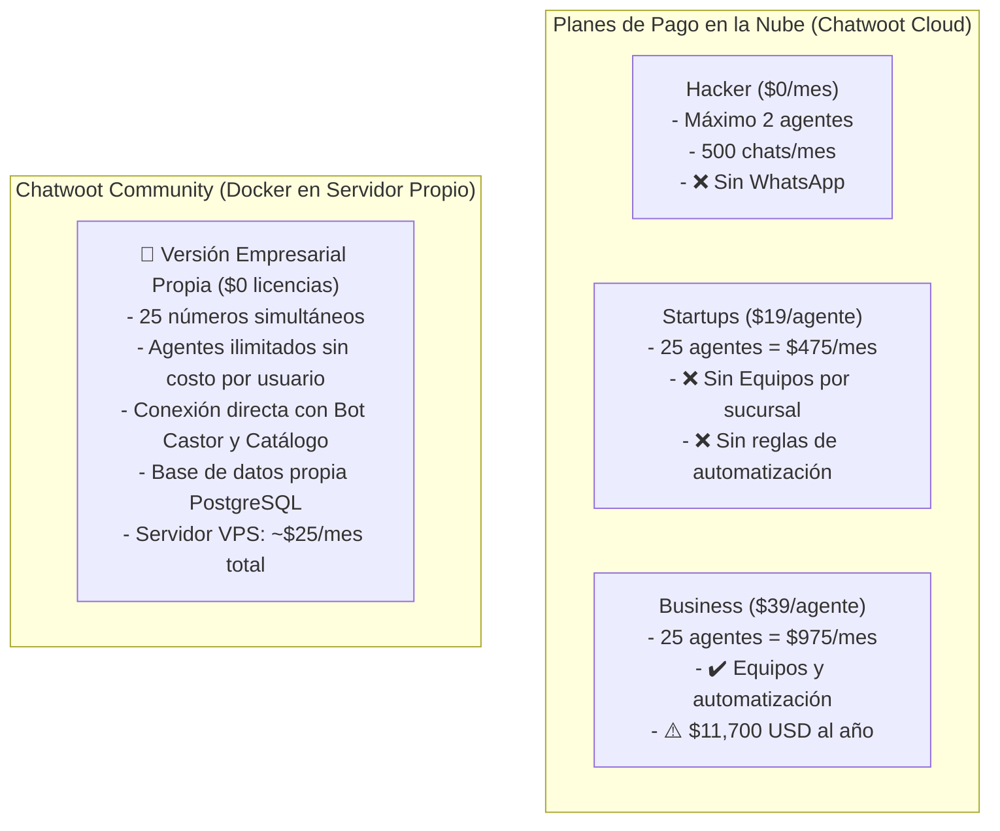

# Reporte Estratégico: Chatwoot Community (Self-Hosted) vs. Planes Cloud (Hacker, Startups, Business)
## Caso de Aplicación: Mega Ferretería Bonilla (Escalabilidad a 25 Números de WhatsApp)

---

## 1. Resumen Ejecutivo y Comparativa Financiera

Para una operación de **25 números de WhatsApp y un equipo de 20 a 25 asesores de ventas**, la decisión entre la nube de Chatwoot (SaaS) y la versión propia autohospedada (Community / Self-Hosted en Docker) tiene un impacto económico y técnico radical:

| Criterio | Plan Hacker ($0) | Plan Startups ($19/agente) | Plan Business ($39/agente) | Chatwoot Community (Self-Hosted / Local) |
| :--- | :---: | :---: | :---: | :---: |
| **Costo Mensual (25 Agentes)** | *No aplicable (máx. 2)* | **$475 USD / mes** | **$975 USD / mes** | **$0 USD en licencias** |
| **Costo Anual en Licencias** | $0 | **$5,700 USD / año** | **$11,700 USD / año** | **$0 USD / año** |
| **Costo de Servidor (Hosting Propio)** | $0 (en su nube) | $0 (en su nube) | $0 (en su nube) | **~$20 - $35 USD / mes** (Total servidor) |
| **Límite de Agentes / Vendedores** | 2 agentes máx. | Por pago ($19 c/u) | Por pago ($39 c/u) | **ILIMITADOS** (25, 50 o 100 sin costo extra) |
| **Canales de WhatsApp Permitidos** | ❌ Ninguno (solo chat web) | ✔️ Incluido | ✔️ Incluido | **ILIMITADOS (los 25 números simultáneos)** |
| **Tokens de API para Chatbot** | ❌ Bloqueados | ⚠️ Restringidos | ✔️ Habilitados | **100% Abiertos y Desbloqueados** |
| **Retención del Historial de Clientes** | 30 días | 1 año | 2 años | **PERMANENTE (Para siempre en tu base)** |
| **Propiedad y Privacidad de Datos** | Nube de terceros | Nube de terceros | Nube de terceros | **100% en tu servidor privado** |

> [!IMPORTANT]
> **Conclusión Financiera Inmediata:**  
> Implementar los 25 números en **Chatwoot Cloud (Business)** le costaría a la empresa **$11,700 dólares al año** solo en suscripciones mensuales.  
> Con la versión **Chatwoot Community autohospedada (Local / VPS propio)**, la empresa ahorra más de **$11,000 dólares anuales**, manteniendo **agentes ilimitados, retención infinita y control absoluto de los datos**.

---

## 2. Análisis Detallado Plan por Plan vs. Necesidades de la Ferretería

### A. Plan Hacker ($0 / mes) — *Inviable para la empresa*
* **Lo que ofrece:** Hasta 2 agentes, 500 conversaciones/mes, 30 días de retención de historial.
* **Por qué NO sirve para la ferretería:**
  1. **No permite WhatsApp:** Solo incluye widget de chat para sitio web. No se pueden conectar líneas de WhatsApp.
  2. **Bloqueo a 2 agentes:** Si tienes más de 2 vendedores, el sistema se bloquea.
  3. **Límite de 500 chats:** Una ferretería con 25 números supera los 500 chats en los primeros dos días del mes.
  4. **Tokens de API bloqueados:** No permite conectar el Chatbot Castor ni pasarelas externas.

---

### B. Plan Startups ($19 / agente / mes) — *$475 USD/mes para 25 agentes*
* **Lo que ofrece:** Conversaciones ilimitadas, canales de WhatsApp habilitados, Help Center básico, 300 créditos de Captain AI, retención de datos por 1 año.
* **Lo que le falta para la ferretería:**
  1. **No tiene división por "Equipos" (Teams):** No puedes agrupar a los vendedores por sucursales (ej. Equipo Sucursal Centro, Equipo Sucursal Norte, Equipo Mayoristas). Todos los chats caen revueltos.
  2. **No tiene "Reglas de automatización":** No puedes programar que si un cliente escribe a las 11:00 PM se le asigne una etiqueta de "Fuera de horario" o se transfiera a guardia.
  3. **Costo acumulado elevado:** Pagar $475 mensuales ($5,700 al año) por funciones que en la versión Community son gratuitas.

---

### C. Plan Business ($39 / agente / mes) — *$975 USD/mes para 25 agentes*
* **Lo que ofrece:** Canales ilimitados, gestión por Equipos, Reglas de automatización avanzadas, Canales de Voz, 500 créditos de IA, retención de datos por 2 años.
* **Ventajas que aporta:**
  - El software está 100% mantenido por el equipo de Chatwoot en sus servidores.
  - No tienes que preocuparte por reiniciar Docker ni mantener copias de seguridad de la base de datos.
* **Desventajas para la empresa:**
  - **Costo exorbitante:** Casi $1,000 USD al mes ($11,700 anuales).
  - Si un mes la ferretería contrata 5 vendedores más, la factura sube $195 USD adicionales cada mes.
  - A los 2 años, Chatwoot borra los historiales de conversaciones antiguos si no pagas almacenamiento adicional.

---

### D. Chatwoot Community (Self-Hosted en Docker Propio) — *La Elección Ganadora*
Esta es la versión que tenemos instalada en tu Docker (`http://localhost:3010`), montada con PostgreSQL, Redis y Sidekiq.

#### ¿Qué ventajas reales tiene para Mega Ferretería Bonilla?

1. **Cero Costo por Asesor (Ahorro del 98%):**  
   Puedes dar de alta a tus 25 vendedores hoy, y el próximo año tener 60 vendedores, y la factura de software sigue siendo **$0**. Solo pagas el servidor en la nube (un VPS como DigitalOcean, Hetzner o AWS de $25 a $35/mes que aloja todo el sistema).
2. **25 Números de WhatsApp sin Restricciones:**  
   Puedes crear 25 bandejas de entrada distintas (Sucursal Centro, Sucursal Norte, Ferretería Sur, Ventas Telefónicas, etc.) y asociar cada número a su bandeja sin pagar adicionales por canal.
3. **Integración Total con el Chatbot "Castor" y el Catálogo Emergente:**  
   Al tener acceso total a la API local (`API Access Token: naCTc3dv6qfvbhfwVar9CmDA`):
   - El bot saluda con el catálogo interactivo.
   - El carrito de compras actualiza las conversaciones automáticamente.
   - Si un asesor responde en Chatwoot, el bot se silencia al instante sin latencia de servidores internacionales.
4. **Historial y Base de Datos 100% de la Empresa (Retención Infinita):**  
   Los datos de clientes, teléfonos, cotizaciones y pedidos nunca se borran a los 30 días ni a los 2 años. Quedan para siempre en tu base de datos PostgreSQL para hacer campañas de marketing, fidelización o análisis contable.
5. **Privacidad y Seguridad Legal:**  
   Las cotizaciones, precios de compra a proveedores y datos bancarios de tus clientes no pasan por servidores de terceros en el extranjero. Todo reside en tu propia infraestructura controlada por Gerencia.

---

## 3. ¿Qué aporta la versión de pago (Cloud) que no tenga la Community?

Para tener una visión 100% transparente, estas son las características exclusivas de la versión Cloud de pago frente a la versión Community básica:

| Característica de Paga | ¿Qué hace? | ¿La necesita la ferretería? | ¿Cómo se suple en Community? |
| :--- | :--- | :---: | :--- |
| **Captain AI (Respuestas con IA generativa de Chatwoot)** | El bot de Chatwoot responde preguntas basado en artículos del centro de ayuda. | ⚠️ Opcional | **Ya tenemos nuestro propio Chatbot Castor** (Python + FastAPI + Qdrant + Catálogo interactivo), el cual es infinitamente más potente y adaptado a ferretería que la IA genérica de Chatwoot. |
| **Canales de Voz (Telefonía IP integrada)** | Permite recibir llamadas telefónicas web dentro de Chatwoot usando Twilio Voice. | ❌ No prioritaria | La atención de la ferretería se realiza 100% por WhatsApp (mensajes, notas de voz y llamadas directas). |
| **Mantenimiento y Actualizaciones Gestionadas** | El equipo de Chatwoot se encarga de parches, backups y servidores. | ✔️ Cómodo | En la versión Community, se programa un script de backup automático semanal de PostgreSQL a Google Drive o S3 por menos de $1 al mes. |

---

## 4. Requisitos de Infraestructura para Producción (25 Números)

Para poner tu versión **Chatwoot Community + Bot Castor + Gateway de WhatsApp** en un servidor productivo en internet con candado HTTPS y alta disponibilidad 24/7, los requerimientos técnicos son:

### Hardware / Servidor VPS Recomendado:
* **Proveedor sugerido:** DigitalOcean, Hetzner, AWS Lightsail o Contabo.
* **Procesador (CPU):** 4 vCPUs.
* **Memoria RAM:** 8 GB de RAM (holgado para PostgreSQL, Redis, Chatwoot Web, Chatwoot Worker, Evolution API y Backend).
* **Disco Duro:** 120 GB SSD / NVMe.
* **Sistema Operativo:** Ubuntu 22.04 LTS o 24.04 LTS.
* **Costo estimado de servidor:** Entre **$24 y $36 USD / mes** (todo incluido).

### Software y Componentes:
* **Docker & Docker Compose:** Todo el stack empaquetado exactamente como lo tenemos estructurado en este proyecto.
* **Dominio Corporativo con SSL:** Ej. `chat.megaferreteriabonilla.com` con certificado gratuito de Let's Encrypt (HTTPS con candado verde).
* **Nginx Reverse Proxy:** Para distribuir el tráfico entre el panel de Chatwoot, el catálogo webview y las pasarelas de WhatsApp.

---

## 5. Recomendación Estratégica Final para Gerencia

1. **Descartar los planes Cloud (Hacker, Startups y Business):**  
   Pagar entre $5,700 y $11,700 dólares anuales en suscripciones por agente es financieramente ineficiente para una empresa con 25 líneas, teniendo a tu disposición la versión Community lista y funcional.
2. **Adoptar Chatwoot Community (Self-Hosted en Servidor VPS Propio):**  
   - Te da el **100% de las funcionalidades requeridas**: 25 bandejas, asesores ilimitados, métricas completas de atención (FRT y ART), auditoría en vivo y notas internas.
   - Te permite conectar tu **Chatbot inteligente Castor con la pantalla emergente del catálogo y carrito de compras**, algo que ningún plan cerrado de Chatwoot ofrece de fábrica.
   - Inversión total mensual: **Menos de $35 USD al mes** por toda la infraestructura de la empresa.
